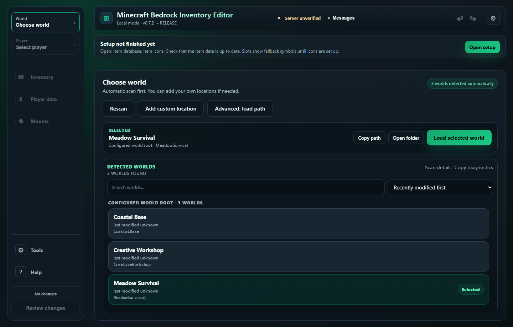
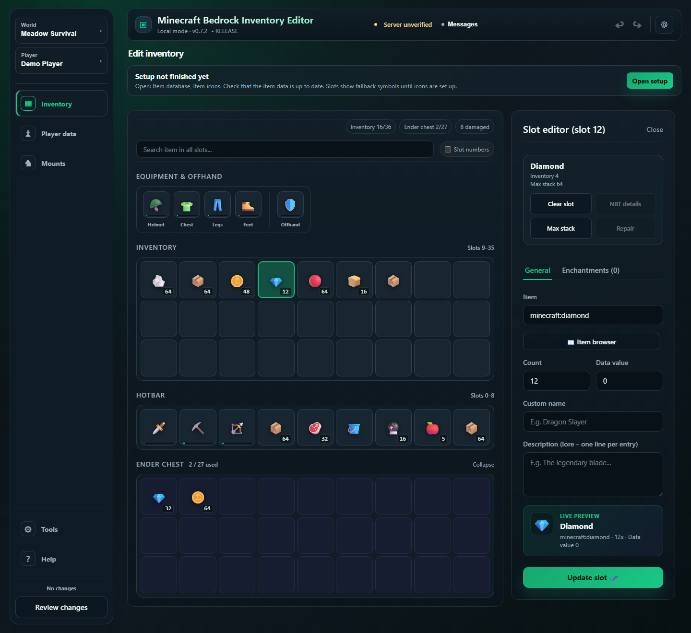

# Minecraft Bedrock Inventory Editor

**🇬🇧 English** | [🇩🇪 Deutsch](README.de.md)

[](https://github.com/dadeeen/MCBE_Inventory_Editor/actions/workflows/ci.yml)
[](LICENSE)
[](#local-windows-setup)

A local web editor for selected Minecraft Bedrock player data: inventory, ender chest, effects, abilities, player values, and experimental mounts.

The interface is available in English and German; use the language switcher in the header.

This is an unofficial community project. It is not affiliated with, endorsed by, or associated with Mojang Studios or Microsoft.

> **Before every edit:** stop Minecraft or the Bedrock server and create a complete, independent copy of the world. Keep that copy until the edited world has been verified in Minecraft. App-created backups are an additional safeguard, not a replacement.

The editor is intended for local use and trusted home networks. Do not expose it directly to the public internet.

Studio layout with example data, an English interface, and built-in placeholder icons:

[](docs/assets/editor-overview.png)

[](docs/assets/editor-inventory.png)

## Download → backup → start

Choose how you want to run the editor:

| Option | Start with | Requirements |
| --- | --- | --- |
| [Portable Windows app](#portable-windows-app) | `_windows_x64.zip` → `MCBEInventoryEditor.exe` | Windows x64 and WebView2; Python is included |
| [Browser on Windows](#local-windows-setup) | `_runtime.zip` → `setup.bat`, then `start.bat` | Python 3.12–3.14 |
| [Docker / LAN](#docker-and-trusted-lans) | Published GHCR image and Compose | Docker with access to the stopped worlds |

All three options use the same editor. Release ZIPs are available on [GitHub Releases](https://github.com/dadeeen/MCBE_Inventory_Editor/releases).

On first start, follow the setup dialog. Download **Item DB** and **Vanilla icons**, and wait for the completion message. You can do this later under **Tools**; until then, the editor uses the bundled item data and placeholder icons.

## Why this exists

The editor was written for a private Bedrock server. Small corrections to a player's inventory or values meant copying world files to a Windows machine every time — far more effort than a routine fix deserves.

The goal was to make those adjustments possible from any device on the same network. The Docker deployment runs alongside the server and the browser interface works from a laptop, tablet, or phone, with no Windows machine and no local copy of the world involved.

That origin explains the scope: a reviewed set of player fields, edited with the world stopped and a backup in place, rather than a general-purpose world editor.

## What it supports

| Area | Scope |
|---|---|
| Inventory | Hotbar, backpack, armor, offhand, moving, copying, and bulk actions |
| Ender chest | Viewing and editing, including transfers between visible areas |
| Player values | Health, game mode, XP, hunger, saturation, position, effects, and walking and flying speeds |
| Safety | Backups before saving, validated restores, and protection against concurrent changes |
| Player transfer | Local ↔ multiplayer migration and complete `.mcbe-player.zip` import/export |
| Icons | Shared Vanilla icons, active world packs, `.mcpack`, `.zip`, and custom icon folders |
| Mounts | Experimental creation of horses, donkeys, mules, skeleton horses, and camels |
| Diagnostics | World status, runtime checks, reports, and private raw-player export |

## Editing items and containers

Items can be edited in the inventory and inside bundles and shulker boxes. The editors offer appropriate controls for wear and known variants.

Valid edits in inventory, equipment and ender chest slots apply immediately to the editor state. Item searches commit on selection or when leaving the field; invalid input stays in the form. Special dialogs for books, banners, fireworks and containers keep their Apply and Cancel buttons. Only saving the player writes changes to the world.

Unknown original values and untouched additional data are preserved. Containers enforce their capacity and nesting rules.

## Portable Windows app

Extract the **entire** release archive ending in `_windows_x64.zip` into a writable directory and double-click `MCBEInventoryEditor.exe`. Keep the EXE and its accompanying `_internal` folder together. No separate Python installation is required.

The app requires **Microsoft Edge WebView2 Runtime**. If it is missing, install the [official Evergreen Runtime](https://developer.microsoft.com/microsoft-edge/webview2/).

Settings, icons and backups live in the `data` directory beside the EXE. Closing the editor prompts you about unsaved edits and waits for active writes to finish.

**Updating:** Close the editor, extract the complete new archive into a new directory and copy your existing `data` directory into it. Start `MCBEInventoryEditor.exe` there.

Startup errors are recorded in `data/desktop.log`. For interrupted restores, follow the [recovery instructions](SECURITY.md#interrupted-restores).

## Local Windows setup

1. Open [GitHub Releases](https://github.com/dadeeen/MCBE_Inventory_Editor/releases).
2. Download the asset ending in `_runtime.zip`. The automatically generated **Source code** archives are not ready-to-run packages.
3. **Optional:** Download the matching `.sha256` file and compare its checksum with the output of `Get-FileHash <runtime.zip> -Algorithm SHA256` in PowerShell.
4. Stop Minecraft or the server and copy the complete world folder to an independent location.
5. Install [Python for Windows](https://www.python.org/downloads/windows/) version **3.12–3.14** if needed. Enable the Python launcher or **Add Python to PATH**.
6. Extract the runtime ZIP, run `setup.bat` once, then start with `start.bat`. The editor opens automatically in your browser. If it does not, open `http://127.0.0.1:5000` yourself.

Keep the command-line window opened by `start.bat` open while using the editor. Closing a browser tab does not stop the editor. Save your changes, then stop it with **Ctrl+C** in the command-line window.

The same startup commands work in a source checkout. Settings, backups and downloaded icons live under `data/`.

**Updating:** Stop the editor, extract the new version into a new directory and copy your existing `data` directory into it. Run `setup.bat` again there, then start with `start.bat`.

## Docker and trusted LANs

For a straightforward setup, use `latest` to pull the current stable image:

```bash
docker pull ghcr.io/dadeeen/mcbe-inventory-editor:latest
```

`latest` follows stable releases. To pin a version, replace `latest` with the version number on the [Releases page](https://github.com/dadeeen/MCBE_Inventory_Editor/releases), without the leading `v`.

Save this example as `compose.yaml` or use it as a stack. Replace `/PATH/TO/BEDROCK/WORLDS` with the existing host directory containing your worlds. Set `MCBE_SERVER_HOST` to your Bedrock server's address as reachable from the container, and adjust its port if needed:

```yaml
services:
  mcbe-editor:
    image: ghcr.io/dadeeen/mcbe-inventory-editor:latest
    restart: unless-stopped
    ports:
      - "8088:8080"
    environment:
      MCBE_SERVER_HOST: "192.168.1.100"
      MCBE_SERVER_PORT: "19132"
    volumes:
      - /PATH/TO/BEDROCK/WORLDS:/worlds:rw
      - mcbe-editor-data:/data:rw

volumes:
  mcbe-editor-data:
```

From the directory containing `compose.yaml`, pull the image and start the editor in the background:

```bash
docker compose pull
docker compose up -d
```

Then open `http://<Docker-Host>:8088` in your browser.

To update, finish your edits and run the same commands again; the data volume is retained. In a stack manager, pull the image and redeploy the stack. `latest` does not update running containers automatically.

The commented [Compose example on GitHub](https://github.com/dadeeen/MCBE_Inventory_Editor/blob/main/docker-compose.example.yml) adds log rotation and container restrictions.

On first open, set a password or explicitly confirm passwordless use on a trusted network. Protect the port with host firewall rules and never add public ingress or a public tunnel.

Important Docker behavior:

- Mount the common parent directory of your worlds at `/worlds` to support full-world restores. Persistent app data and backups live under `/data`; keep this volume persistent.
- `MCBE_REQUIRE_SERVER_OFFLINE=true` is the default. A reachable configured Bedrock server blocks writes; unknown status requires confirmation. For NetherNet, the editor also needs access to the server's TCP port.
- For read-only access, use both `MCBE_READ_ONLY=true` and `/worlds:ro`, as in the [viewer example](https://github.com/dadeeen/MCBE_Inventory_Editor/blob/main/docker-compose.viewer.example.yml). Docker's `read_only: true` alone does not protect mounted worlds.
- The container runs as non-root UID/GID `10001`. Configure the required [write permissions for Docker worlds](#write-permissions-for-docker-worlds) before the first save.

### Write permissions for Docker worlds

The following guide explains filesystem access. Full-world restores also require the editor to preserve owners, groups and permissions; ACL or group write access alone does not guarantee this. For full restore support, use the same unprivileged UID/GID for the editor and server as described below.

<details>
<summary>Configure and diagnose Docker world permissions</summary>

A `:rw` mount alone does not grant write permission. An error such as

```text
IO error: /worlds/MyWorld/db/LOCK: Permission denied
```

means that UID `10001` cannot write to the database directory or create `LOCK` there.

Stop the Bedrock server before making any of the following changes and first resolve the actual mounted host path:

```bash
docker inspect mcbe-editor --format \
  '{{range .Mounts}}{{println .Source "->" .Destination "Mode:" .Mode}}{{end}}'
```

Replace `mcbe-editor` with your container name when necessary.

#### Recommended: targeted ACL for UID 10001

This keeps the server files' existing owner and group while granting only the editor additional access. On Debian/Ubuntu, install the `acl` package first when needed (use the corresponding package manager on other distributions), then set `WORLDS_ROOT` to the host path that `docker inspect` shows for `/worlds`:

```bash
sudo apt-get install -y acl

WORLDS_ROOT="/var/lib/docker/volumes/MY_VOLUME/_data/worlds" # Replace this example path

sudo setfacl -R -m u:10001:rwX "$WORLDS_ROOT"
sudo find "$WORLDS_ROOT" -type d -exec setfacl -m d:u:10001:rwX {} +
```

The default ACL on each directory lets newly created files and subdirectories inherit editor access.

Verify the actual world directory afterwards. `ls /worlds` prints the real folder names, so set `WORLD` to one of them rather than leaving the placeholder in place:

```bash
docker exec mcbe-editor sh -lc '
id
ls /worlds
WORLD=/worlds/MyWorld/db
if [ ! -d "$WORLD" ]; then
  echo "Path not found: $WORLD"
elif [ -w "$WORLD" ]; then
  echo "World database is writable"
else
  echo "World database is NOT writable"
fi
'
```

#### Compatibility mode: shared group or shared UID

If ACLs are not reliably available on the host filesystem, the Bedrock server and editor can deliberately use a dedicated shared group. Example with GID `12000`:

```yaml
services:
  mcbe-editor:
    group_add:
      - "12000"
```

On the host, the world files must belong to that group, be group-writable, and make new subdirectories inherit the group:

```bash
WORLDS_ROOT="/var/lib/docker/volumes/MY_VOLUME/_data/worlds" # Replace this example path

sudo chgrp -R 12000 "$WORLDS_ROOT"
sudo chmod -R g+rwX "$WORLDS_ROOT"
sudo find "$WORLDS_ROOT" -type d -exec chmod g+s {} +
```

The Bedrock server process needs the same supplemental group. Both processes must create new files as group-writable, typically with `umask 0002`; without that shared umask, group mode is not reliable for files created later.

For maximum compatibility, both containers can instead deliberately run under the same **unprivileged** UID/GID:

```yaml
services:
  mcbe-editor:
    user: "1234:1234"  # Example: the same UID/GID as the Bedrock server
    volumes:
      - /srv/bedrock/worlds:/worlds:rw
      - /srv/mcbe-editor-data:/data:rw
```

Before startup, `/srv/bedrock/worlds` and `/srv/mcbe-editor-data` must be writable by that identity. Never use UID `0` here.

Every process in the shared group or using the shared UID can modify the worlds. Use a dedicated group or unprivileged service UID, never a broadly shared system group.

Unsupported shortcuts:

- do not run `chmod -R 777` on world or data directories;
- do not add `privileged: true` or run the editor as root to bypass filesystem permissions;
- do not delete LevelDB's `db/LOCK` file or disable locking to bypass a running server.

</details>

## Safe workflow

1. Stop Minecraft or the Bedrock server.
2. Create an independent copy of the complete world.
3. Select the world and player in the editor.
4. Make and review the changes.
5. Save. An actual write creates a backup first.
6. Close the editor, open the world in Minecraft, and verify the result.
7. Keep the independent copy until verification is complete.

The editor does not stop or start Minecraft or a Bedrock server itself.

## Player migration and import

**Local ↔ multiplayer migration** transfers selected player data while preserving the destination player's identity. The destination multiplayer player must already have joined the world once. The source player is retained; pet ownership is not transferred.

A `.mcbe-player.zip` import replaces the complete player record with the exported data. Verify the resulting player in Minecraft.

Player exports contain non-anonymized data. Keep them private and do not attach them to public issues or commit them to a repository.

## Experimental mounts

The Mounts view lets you stage mounts near the player in the Overworld. The placement check shows:

- **Green:** placement allowed.
- **Yellow:** placement uncertain; confirmation required.
- **Red:** placement blocked.

Player changes and staged mounts are written to the world together when you save. This feature is experimental; test it on expendable world copies first.

## Data safety and privacy

- Editing works offline. **Item DB** and **Vanilla icons** updates and the optional network check need internet access over HTTPS. Each update tab shows failures and a collapsible technical log. GitHub rate limits include the earliest retry time when supplied by GitHub.
- Before saving, the editor checks server status, file locks and concurrent changes. It creates a full-world backup before each actual change.
- If a restore is interrupted or its outcome is uncertain, keep the backup and recovery files and follow the [recovery instructions](SECURITY.md#interrupted-restores) before editing further.
- World folders must contain ordinary files and directories. Symlinks, Windows junctions and other reparse points are unsupported.
- Backups and restores default to **1 GiB uncompressed** and **50,000 entries** per archive. Check the size limit under **Tools → Backup Manager** and keep enough free disk space for backup and restore copies.
- Worlds, backups, exports and diagnostics can contain personal information. Keep them private.

The [security policy](SECURITY.md) covers deployment, recovery and vulnerability reports. The [save contract](https://github.com/dadeeen/MCBE_Inventory_Editor/blob/main/docs/save_contract.md#backups-and-restore) describes backup limits and validation in detail.

## Compatibility and limitations

- The server check does not replace stopping Minecraft or the Bedrock server.
- Not all Bedrock versions, add-ons and world formats are covered. Verify changes in Minecraft.
- The editor blocks writes when it detects database errors or missing files. It does not repair damaged databases.

## Development and license

Bug reports and contributions are welcome. Use synthetic examples and sanitized logs without personal information or credentials.

See the [developer documentation](https://github.com/dadeeen/MCBE_Inventory_Editor/blob/main/docs/development.md) for contributor guidance. The [Bedrock engine checks](https://github.com/dadeeen/MCBE_Inventory_Editor/blob/main/docs/engine-checks.md) describe tested versions, coverage and limitations.

The project's own code is licensed under the [MIT license](LICENSE). Dependencies have their own licenses.

Minecraft content belongs to Mojang Studios/Microsoft and remains subject to their terms. The bundled item database is based on `Mojang/bedrock-samples` and Microsoft Learn; vanilla icons are downloaded only on request.

Key upstream projects include [Amulet Team](https://github.com/Amulet-Team), Flask and the Pallets team, and the [Minecraft Wiki](https://minecraft.wiki/) as a reference for manually verified gameplay mechanics.
